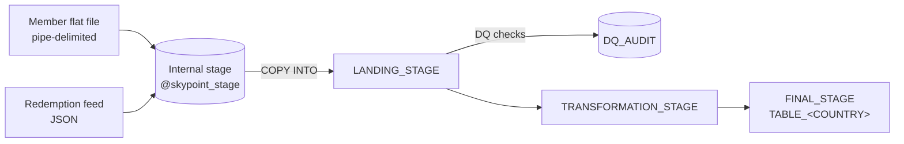

# SkyPoints – Project Architecture

A Snowflake pipeline that loads two daily feeds from the SkyPoints loyalty program and splits members into one table per country. When a member moves country, the **latest record wins**.

## Flow



## Layers

| Layer | Schema | What happens | Main objects |
|---|---|---|---|
| Ingestion | `LANDING_STAGE` | Files are loaded as-is: members as text, redemptions as `VARIANT`. File name and row number are kept on every row. | `LANDING_MEMBERS`, `LANDING_REDEMPTIONS` |
| Data quality | `LANDING_STAGE` | Not-null, uniqueness, accepted-values and freshness checks, run once per file. | `DQ_AUDIT`, `SP_DQ_AUDIT_MEMBERS`, `SP_DQ_AUDIT_REDEMPTIONS` |
| Transformation | `TRANSFORMATION_STAGE` | Type casting with `TRY_TO_*`, trimming, derived `AGE` and `STALE_MEMBERS` (more than 90 days since the last flight), JSON flattened to one row per transaction. | `INT_MEMBERS`, `INT_MEMBERS_DERIVED`, `INT_FLAT_REDEMPTIONS` |
| Final | `FINAL_STAGE` | Members are routed to their country table through a mapping table. Unknown countries go to a catch-all table. | `COUNTRY_TABLE_MAP`, `TABLE_USA`, `TABLE_INDIA`, …, `TABLE_UNMAPPED_COUNTRY` |

## Repository

```
Ingestion/       stage, file formats, landing DDL, COPY scripts
DQ_Check/        DQ_AUDIT table and DQ procedures
Transformation/  intermediate tables, derived columns, JSON flattening
Final/           country table template, country tables, country mapping
```

## Key design decisions

- **Raw first, cast later.** One bad value never fails a load. It is caught by DQ.
- **Lineage on every row.** File name and row number support auditing, reprocessing and the latest-record ordering.
- **Metadata-driven split.** Adding a country is one row in `COUNTRY_TABLE_MAP`.
- **Redemptions join to members** on `MEMBER_ID`. A INNER JOIN surfaces redemptions whose member is missing.

## Scaling (billions of rows per day)

Snowpipe loading of chunked files ·  `QUALIFY ROW_NUMBER()` dedup per batch · clustering on `MEM_ID` and `FILE_DATE` · separate warehouses for ingestion and transformation.# skypoints
Project
