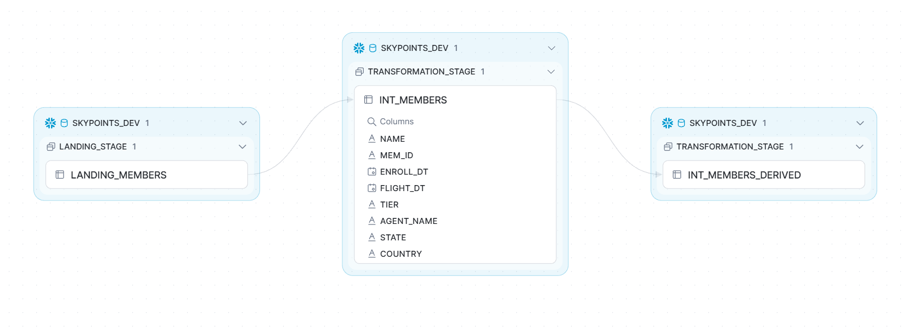
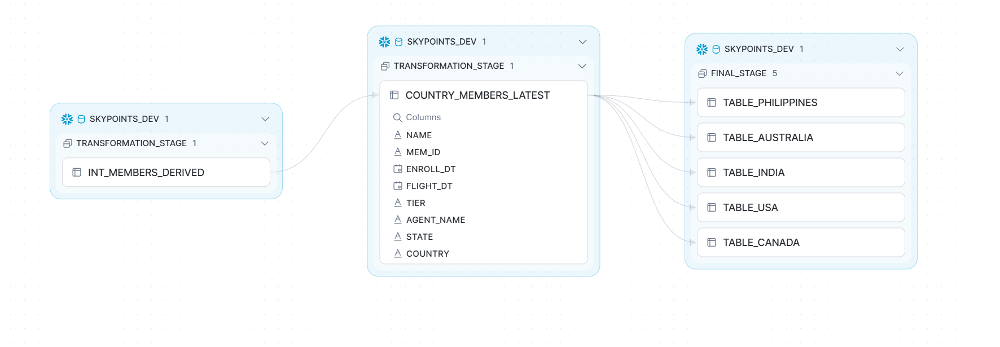
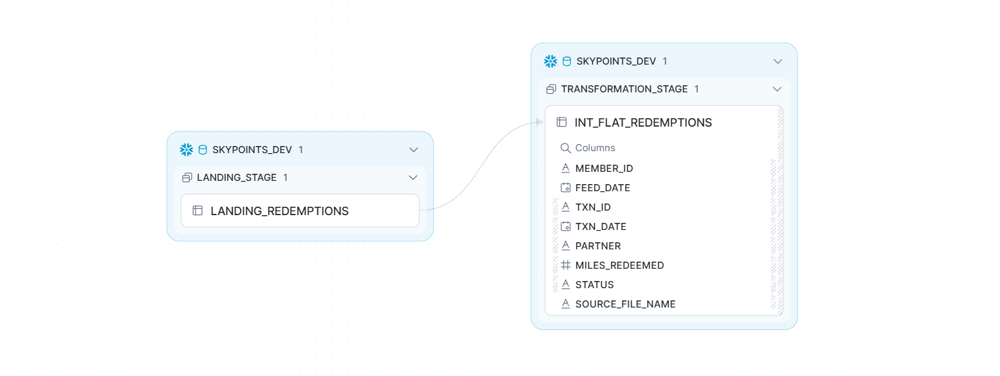

# Transformation

Turns raw landing data into typed, cleaned and enriched tables in `SKYPOINTS_DEV.TRANSFORMATION_STAGE`. These tables feed the country split in `Final/`.

## Contents

| File | Purpose |
|---|---|
| `Create_int_table.sql` | Creates `INT_MEMBERS` (typed member table) |
| `Load_int_members.sql` | Loads `LANDING_MEMBERS` → `INT_MEMBERS` (`INSERT OVERWRITE`) |
| `dervied_col_members.sql` | Creates and loads `INT_MEMBERS_DERIVED` with derived columns |
| `latest_record_country_members.sql` | Builds `COUNTRY_MEMBERS_LATEST` (latest file's record per member) |
| `flattening_redemption_landing.sql` | Creates `INT_FLAT_REDEMPTIONS` and flattens the redemptions JSON into it |

## Members flow

**1. `INT_MEMBERS`: typing and cleansing**
- `TRIM` on every field. `UPPER(NULLIF(..., ''))` on tier, agent, state and country, so blank values become `NULL`.
- Dates are parsed with `TRY_TO_DATE`, so bad values become `NULL` instead of failing the load: enrollment and last-flight dates use `YYYYMMDD`, DOB uses `DDMMYYYY`.
- `FILE_DATE` is the date taken from the digits in `source_file_name`.
- `PK(MEM_ID)` is informational only; Snowflake doesn't enforce it.

**2. `INT_MEMBERS_DERIVED`: derived columns**
- `AGE` = `DATEDIFF('YEAR', DOB, CURRENT_DATE())`
- `STALE_MEMBERS` = `'Y'` if the last flight was more than 90 days ago, otherwise `'N'`
- `CURR_DATE` = the processing date

**3. `COUNTRY_MEMBERS_LATEST`: latest record wins**
- Keeps each member's row from the file with the latest `FILE_DATE` (`MAX(FILE_DATE) OVER (...)` + `QUALIFY`).

**Lineage**

## Redemptions flow

**`INT_FLAT_REDEMPTIONS`: flattening the JSON**
- Takes `member_id` and `feed_date` from the top level of the payload.
- Turns each element of `payload:redemptions` into its own row (`LATERAL FLATTEN`), with `txn_id`, `txn_date`, `partner`, `miles_redeemed` and `status`.
- Dates are parsed with `TRY_TO_DATE` and numbers with `TRY_TO_NUMBER`. Lineage columns (`source_file_name`, `source_file_row_number`, `loaded_at`) are carried over.

**Lineage**

## Run order

1. `Create_int_table.sql`
2. `Load_int_members.sql`
3. `dervied_col_members.sql`
4. `latest_record_country_members.sql`
5. `flattening_redemption_landing.sql` (doesn't depend on steps 1–4)

Next step: `Final/` (one table per country from `COUNTRY_MEMBERS_LATEST`).